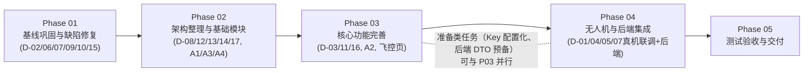

# 02 - 总体开发计划（Sky / 天枢巡检）

> 执行范围更新：依队员分工，本轮交付 F07/F08/F09/F11 的无无人机阶段能力。原阶段计划中相关任务按 [航线与模拟巡检契约](contracts/fzp-route-mission-contracts.md) 及 [验收记录](07-冯梓鹏模块交付与验收.md) 核对。F02/F03、正式空域数据、F10 航点动作和 F12 真机飞控仍是实飞阶段依赖。本轮按用户明确指令在 `master` 提交并同步，不另建分支。

> 制定依据：代码基线 `30772d3` 的全面审计（`docs/00-项目接手审计报告.md`）与现状说明（`docs/01-项目现状说明.md`）。
> 本计划采用 Superpowers 的 writing-plans 方法论组织（分阶段 → 可独立验证的原子任务 → 每任务有测试与验证命令），阶段计划见 `docs/phases/`。
> **不含无依据的完成日期**；工作量按"AI 代理工作日（1 个工作日 ≈ 一次专注的代理执行会话 + 人工复核）"给出粗估，假设条件见 §9。

---

## 1. 项目总体目标

将"天枢巡检"从**演示就绪、交付未就绪**的当前状态，推进到：

1. **真机可飞**：航线规划 → KMZ 上传 → 起飞 → 按航点巡拍 → 返航 的真机闭环可用；
2. **安全可信**：返航高度/失控行为/低电量返航/起飞前检查真正生效，UI 不再有"假成功"；
3. **数据真实**：任务中心接入真实数据源（先本地真实化，后后端），演示数据显式隔离；
4. **可维护**：死代码清理、注册/遥测/设置收口、巨型类拆分、测试覆盖关键纯逻辑；
5. **可交付**：登录 + 最小后端 + 签名/图标/更新检查齐备（交付目标视后端资源到位情况伸缩）。

## 2. 当前基线 `[已验证]`

- 分支 `master`，commit `30772d3`，工作区干净；
- `./gradlew :app:assembleDebug` 成功（约 5 分钟，APK ≈181MB）；`testDebugUnitTest` 6/6 通过；
- 环境：`E:\andirod_sdk`（API 36 齐备）+ JDK 17（JAVA_HOME）+ Gradle Wrapper 8.13；
- 已知 18 项问题（D-01~D-18）与 7 项信息安全风险（S-01~S-07），见审计报告 §11/§9。

## 3. 开发范围

**本轮范围内**：审计报告列出的 D-01~D-18 全部处理、模拟链路完善、真机链路打通、安全链路下发、最小后端对接（若外部资源到位）、测试与交付准备。

**不在本轮范围内**：真实 AI 缺陷识别算法（仅预留数据通路与接口）、多机型适配矩阵（先以现有 App Key 对应机型为准）、iOS/Web 端、MVP 之外的高级功能（电子围栏编辑、多机协同、离线地图包制作等列为 backlog）。

## 4. 技术原则（引用 Superpowers 执行规范）

1. **TDD 铁律**：任何生产代码先有失败测试（`test-driven-development`）；纯逻辑（导出器、校验器、状态机）必须进 JVM 单测，Android 组件依赖 Robolectric 或接口隔离。
2. **先证后断**：任何"完成"声明必须附验证命令与输出（`verification-before-completion`）。
3. **根因优先**：缺陷按 `systematic-debugging` 四阶段处理，禁止症状式补丁。
4. **模拟/真实分离**：所有无人机能力必须可离线运行（模拟实现），真机实现单独注入。
5. **加固包约束**：触碰 `dji.v5.*` 必须保持 `Helper.install` 时序，新增 DJI 调用优先走 DroneManager 收口而非直接 import。
6. **Git 安全**：只在 `feature/phase-*` 分支工作；不改历史；合并前必须代码审查；业务代码修改需用户批准（本次接手约束延续）。
7. **小步提交**：每任务一提交，信息格式 `phase-NN: task-N 描述`。

## 5. 模块优先级与阶段划分

依据审计结论调整了初始五阶段划分（原"环境与基线修复"已提前完成——基线构建绿色，故 Phase 01 转为"缺陷修复与死代码清理"）：

| 阶段 | 名称 | 解决的核心问题 | 粗估工作量 | 依赖外部资源 |
|---|---|---|---|---|
| Phase 01 | 基线巩固与缺陷修复 | 让代码库诚实、干净、低风险；修交互 Bug 与竞态；死代码隔离 | 3~5 工作日 | 无 |
| Phase 02 | 架构整理与基础模块 | 统一注册状态源/遥测总线；设置去假象；数据层去 Mock 固化；DB 升级策略 | 5~8 工作日 | 无（模拟器即可） |
| Phase 03 | 核心功能完善 | 飞控指令接口（起降返航）；WPML 拍照动作；飞行控制页实装；禁飞区检查；任务中心与航线打通 | 8~12 工作日 | 无（模拟器）；真机验证延至 P04 |
| Phase 04 | 无人机及后端集成 | 真机联调闭环（D-01/D-04/D-05 验证）；LLM Key 配置化；最小后端（登录/任务/记录）对接 | 10~15 工作日 | **DJI 无人机 + 有效 App Key；后端资源** |
| Phase 05 | 测试、验收与交付 | 全量回归、安全核销、签名/图标/更新检查、交付文档 | 5~8 工作日 | 签名密钥 |

> 阶段顺序不可跳越（P3 的指令接口是 P4 真机联调的前提）；P3 与 P4 的"模拟可验证部分"可并行。

## 6. 阶段交付成果与里程碑

| 里程碑 | 交付物 | 可验证的完成标志 |
|---|---|---|
| M1（P01 完） | 缺陷修复分支合并；死代码隔离；`assembleDebug + testDebugUnitTest` 绿色且新增单测覆盖修复点 | 任务中心第二组任务可点击进详情；语音在线降级不再卡死；构建时间无回退 |
| M2（P02 完） | 注册状态统一（`SdkRegistry`）、遥测总线、设置真实反馈、演示模式开关、DB 迁移策略 | kami REAL 上传的注册检查读真实状态；设置页能如实提示"未实现/已下发"；Mock 不再固化入库 |
| M3（P03 完） | `FlightControlApi`（含模拟实现）、WPML 含 actionGroup、飞控页可用、禁飞区三时点检查 | 模拟器模式跑通"规划→起飞→按点巡拍→返航"全流程（模拟实现层）；导出的 KMZ 结构校验通过（wpmzsdk 或等价 XML 断言，依 P02 的依赖去留决策） |
| M4（P04 完） | 真机闭环 + 最小后端 | 真机完成一次完整巡检任务并回传记录；登录后任务数据来自后端 |
| M5（P05 完） | release 签名包 + 交付文档 + 回归报告 | 全部 P0/P1 问题核销；安全清单 S-01~S-07 处置完毕 |

## 7. 质量门禁

每个任务/阶段必须通过：

1. `./gradlew :app:assembleDebug` 退出码 0；
2. `./gradlew :app:testDebugUnitTest` 全绿（0 失败 0 跳过）；
3. 新增/修改的纯逻辑有对应单测（TDD 红-绿记录）；
4. 触碰 DJI 时序的改动：模拟器冒烟（initSDK → enableSimulator → 遥测）通过；
5. 文档一致性：改动若使 `docs/00~05` 描述过时，同一提交内更新；
6. 无人机安全相关改动（返航/失控/低电/禁飞区）：除单测外必须列入真机验证清单（P04 执行）。

## 8. 风险与阻塞条件

| 风险 | 影响 | 应对 |
|---|---|---|
| **R1 设备阻塞**：无 DJI 无人机或 App Key 失效/包名不匹配 | P04 真机联调与 P03 安全项的真机验证无法进行 | P03 以前全部任务用模拟器推进；进入条件见 `docs/phases/phase-04.md` §E；必要时申请新 App Key（包名决策一并处理） |
| **R2 后端资源未到位** | P04 后端部分无法启动 | 后端部分拆为独立子阶段 P04b，仅在外部确认后启动；期间 App 侧按 14 表设计完成 DTO/Repository 预留 |
| **R3 加固包脆弱性**：重构触碰 DJI 初始化时序引发运行时崩溃 | P02/P03 | 严格保持 attachBaseContext→Helper.install 首位；每次触碰后跑模拟器冒烟；kami 反射网关在 A1 完成前不动 |
| **R4 单提交仓库无历史** | 回归定位困难 | 从 Phase 01 起建立规范的分支与提交历史；发布前打 tag |
| **R5 瓦片服务可达性**（高德未拼 Key、天地图死路） | 航线规划地图空白 | P03 处理 D-16：优先 demotiles 确认链路，再决策高德 Key 拼接或改用正式底图方案 |
| **R6 Mock 演示惯性**：客户演示依赖假数据 | P02 数据真实化可能影响演示 | 引入"演示模式"开关而非直接删除 Mock |

## 9. 工作量估计的假设条件

- 假设 1：以当前审计掌握的代码事实为唯一输入，不再出现大规模未知改动；
- 假设 2："AI 代理工作日"由可并行派发的代理任务组成，人工复核时间已含 30%；
- 假设 3：R1/R2 外部资源在第 4 阶段中段到位；若延迟，P04 真机部分顺延但不阻塞 P05 的模拟侧验收；
- 假设 4：不发生 DJI MSDK 版本升级（保持 5.18.0）。

## 10. 测试策略

| 层级 | 范围 | 工具 | 门禁 |
|---|---|---|---|
| JVM 单测 | 优化器/校验器/WPML 导出器/避障状态机/Repository 决策/PreferenceManager 约束 | JUnit4（现有），必要时 Robolectric | 全绿 |
| 模拟器集成冒烟 | initSDK → registerApp → enableSimulator → 遥测回调；kami SIM 演示闭环 | AVD（`E:\Android\avd`）+ adb 脚本 | 冒烟通过 |
| 真机验收（P04） | 注册/连接/拍照/录像/任务上传/起飞/巡拍/返航/失控测试（对空安全环境） | DJI 机型 + 现场记录表 | 清单核销 |
| 静态检查 | 弃用 API 清理、lint | `./gradlew :app:lintDebug` | 无 Error 级 |
| 安全清单 | S-01~S-07 逐项处置 | 人工核对 | 核销 |

## 11. 验收标准（总体）

1. 审计报告 D-01~D-18 每项标注"已修复/已规避/明确接受"，无悬空 P0/P1；
2. 模拟器模式：完整演示"规划航线 → 模拟起飞巡拍 → 任务记录 → PDF 导出"且数据非 Mock 固化；
3. 真机模式（若 R1 解除）：完成 ≥3 次完整巡检飞行，返航/失控/低电量行为与设置一致；
4. 设置页任何"成功"提示均有真实下发证据（回调为真）；
5. release 变体可签名打包，App 图标与名称正式；
6. `docs/` 全部与代码同步，交叉审查记录在案。

## 12. 各阶段使用的 Skill 与详细计划链接

| 阶段 | 详细计划 | 主要 Skill（本地实际名称，路径 `E:\WorkBuddy_International\skill\`） |
|---|---|---|
| 通用入口 | — | `using-superpowers`（每次会话首个动作） |
| Phase 01 | `docs/phases/phase-01.md` | `brainstorming`(bounded) → `writing-plans` → `executing-plans` + `test-driven-development`；缺陷用 `systematic-debugging`；收尾 `verification-before-completion` + `requesting-code-review` |
| Phase 02 | `docs/phases/phase-02.md` | 同上 + `subagent-driven-development`（独立任务并行）；数据层设计先用 `brainstorming`(architectural) |
| Phase 03 | `docs/phases/phase-03.md` | 同上；安全项设计走 architectural 路径并留 spec |
| Phase 04 | `docs/phases/phase-04.md` | 同上；设备阻塞用 `execution` 阶段 E 流程；真机清单人工执行 |
| Phase 05 | `docs/phases/phase-05.md` | `verification-before-completion`、`requesting-code-review`（整分支审查）、`finishing-a-development-branch` |
| 分支隔离 | — | `using-git-worktrees`（每阶段开工时） |

> 执行规范细节（含调用方式与验证方法）见 `docs/05-Skill调用与执行规范.md`。
