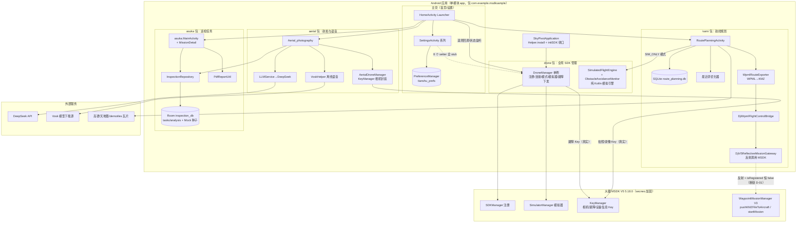
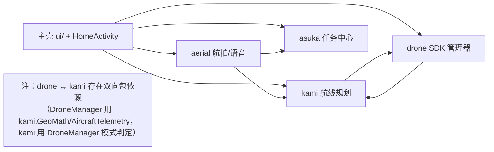
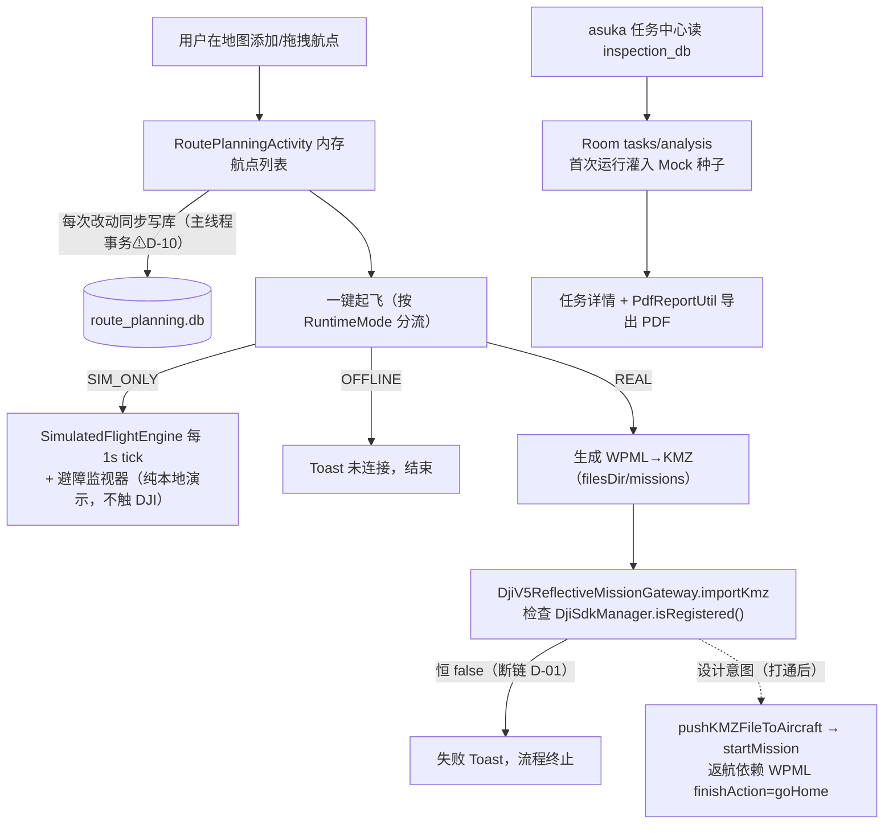
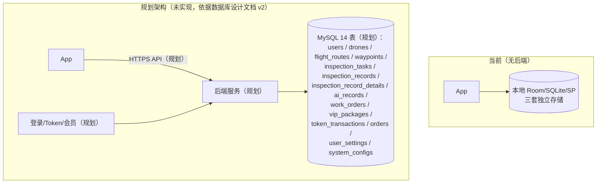

# 03 - 技术架构（Sky / 天枢巡检）

> 当前航线模块增量：页面编辑经 IO 协程调用既有 `RouteRepository`，保存、拖拽、优化和执行统一通过 `RouteSafetyValidator`。`route_planning.db` 无损升级至 v2，新增运行、航点快照及事件表。本地任务链为 `RoutePlanningActivity → LocalMissionRuntime → MissionRunRepository → SQLite`，复用 `SimulatedFlightEngine`，不经过 DJI 网关。详情见 [模块契约](contracts/fzp-route-mission-contracts.md)。下文旧 REAL 链路保留为真机联调待办。

> 原生运行边界：`SkyPivotApplication` 只在原生 ARM64 主机加载 DJI 加固库。x86 模拟器即使提供 ARM 转译也不加载该库，避免进程级原生崩溃；`DroneManager` 的 SDK 回调延迟构造，未接入 SDK 时仍可读取离线状态。ARM64 真机初始化路径保持原有调用顺序，仍待设备验证。

> 依据代码基线 `30772d3` 的实际代码分析。所有组件均标注"当前"或"规划"；规划组件不会与当前组件混绘。

---

## 1. 当前架构总览

### 1.1 语言与技术栈 `[已验证]`

| 维度 | 实际情况 | 证据 |
|---|---|---|
| 语言 | 纯 Kotlin（main 源集 83 个 .kt 文件，另 3 个 JVM 单测 + 1 个 androidTest 模板；无 Java） | 全仓扫描 |
| UI 技术 | 传统 View 体系 + ViewBinding；无 Compose、无 MVVM 框架（无 ViewModel/LiveData 使用） | `app/build.gradle.kts:38-40`；各 Activity 直接持有 View |
| 异步 | 协程（lifecycleScope/MainScope）+ Handler + 少量裸 Thread | `HomeActivity.kt:142`、`RoutePlanningActivity.kt:94`、`VoskHelper.kt:66` |
| 构建 | Gradle 8.13 + AGP 8.12.0 + kapt，单模块 `:app` | `build.gradle.kts`、`settings.gradle.kts` |
| 依赖注入 | 无（手动单例：DroneManager、PreferenceManager、AppDatabase、各 Repository） | 各类 `getInstance()` |
| 状态管理 | 无统一方案：页面各自拉取 + 回调更新；asuka 侧有 Room Flow（唯一响应式点） | `TaskDao.getAllTasks(): Flow` |

### 1.2 模块结构（物理包 = 历史子项目，非逻辑分层）

```
com.example.msdksample
├── SkyPivotApplication   ← 唯一生效 Application：加固注入 + DJI 初始化收口
├── HomeActivity          ← Launcher
├── drone/    ← 全局 SDK 管理层（DroneManager 单例）+ 纯 Kotlin 模拟飞行引擎
├── aerial/   ← 航拍/语音/LLM 子模块
├── kami/     ← 航线规划子模块（数据/地图/任务网关/优化器）
├── asuka/    ← 巡检任务子模块（Room/仓库/PDF）
└── ui/ base/ utils/ ← 主壳页面与工具
```

包间依赖关系（实测引用）：主壳依赖全部三个子模块；aerial 依赖 asuka（共享 Room 仓库）与 kami（跳转）；kami 依赖 drone（模式判定 + 模拟引擎）；drone 依赖 kami 的 GeoMath/AircraftTelemetry；asuka 除被引用外不依赖其他子模块。

### 1.3 状态与数据持久化 `[已验证]`

| 存储 | 库名 | 内容 | 消费方 |
|---|---|---|---|
| Room（asuka） | `inspection_db` v1 | `tasks`、`analysis` 两表；空库自动灌 Mock 种子 | asuka 全部页面、aerial.Aerial_photography |
| SQLiteOpenHelper（kami） | `route_planning.db` v1 | `routes`、`waypoints` 两表（外键级联，上限 3 条航线） | kami.RoutePlanningActivity |
| SharedPreferences | `tianshu_prefs` | 10 个设置 key（返航高度/失控行为/新手模式/避障/灵敏度/画质等） | 主壳设置页、drone.DroneManager（避障动作） |
| 文件系统 | `filesDir/missions/*.kmz`、`getExternalFilesDir/TianshuInspection/reports/*.pdf` | WPML 任务包、PDF 报告 | kami 导出、asuka 报告 |

### 1.4 网络请求 `[已验证]`

全项目**只有三个外网用途**，无业务后端：

1. DeepSeek Chat API（`https://api.deepseek.com/v1/chat/completions`，OkHttp + Gson，Bearer 鉴权，Key 为占位符）— aerial 语音意图。
2. Vosk 模型下载（`https://alphacephei.com/vosk/models/...zip`）— aerial 语音初始化。
3. MapLibre 在线栅格瓦片（高德/天地图/demotiles）与 Unsplash 演示图片（Glide）。

### 1.5 后台任务

无 Service/WorkManager（仅 Manifest 注册了 DJI 自带 `dji.sdk.base.DJIService`）。后台行为全部由协程循环 + 主线程 Handler 循环承担（模拟遥测 1s 循环、避障演示 1s tick、连接轮询 500ms×30）。

### 1.6 第三方 SDK 关键约束

DJI MSDK V5 5.18.0 是 **secneo 加固 AAR**：编译期 API 来自 `compileOnly` 的 provided jar，运行期由 `com.cySdkyc.clx.Helper.install()` 在 `attachBaseContext` 解密注入（`SkyPivotApplication.kt:21-48`）。**任何提前触碰 `dji.v5.*` 的代码都会 NoClassDefFoundError**——这解释了 kami 采用反射网关、三个旧 Application 失效等设计。kapt（Room）与 viewBinding 均已启用。

---

## 2. 架构图（当前系统）

### 2.1 系统总体架构图



### 2.2 Android 应用模块关系图



> 页面跳转实况（入口唯一性已核实）：`HomeActivity` 是唯一 Launcher；`ui.flight.FlightControlActivity`、`ui.route.RoutePlanActivity`、`ui.mission.MissionCenterActivity`、`ui.vip.VipActivity`、`aerial.MainActivity`、`kami.KamiMainActivity` 六个 Activity **无任何入口**（死代码）。

### 2.3 核心数据流图（巡检任务）



### 2.4 无人机指令调用流程图（当前实际存在的调用）

```mermaid
flowchart LR
    subgraph 真实存在的 DJI 调用（当前可用）
        R1[SkyPivotApplication.attachBaseContext] --> R2[Helper.install 加固解密]
        R2 --> R3["DroneManager.initSDK<br/>SDKManager.init → registerApp"]
        R3 --> R4[SDKManagerCallback<br/>连接/注册状态]
        R5[HomeActivity 设备卡连点5次] --> R6["enableSimulator（Debug 守卫）<br/>SimulatorManager"]
        R7[航拍页拍照/录像] --> R8["AerialDroneManager<br/>KeyManager: 相机模式/拍照/录像"]
        R9[设置页避障项] --> R10["DroneManager.setObstacleAction<br/>CapabilityManager 预检 + KeyManager 下发"]
    end
    subgraph 设计存在但断链（当前不可用）
        X1[kami 一键起飞 REAL] --> X2["gateway 检查 isRegistered()<br/>（DjiSdkManager 未初始化，恒 false）"]
        X3[真机遥测] --> X4["startTelemetry REAL 分支 = TODO<br/>电量/信号 Key 未接"]
    end
    subgraph 完全不存在（规划）
        P1[起飞/降落/返航/悬停/虚拟摇杆]
        P2[返航高度/失控行为/低电量下发]
        P3[图传解码与实时画面]
    end
```

### 2.5 后端交互架构图（当前 vs 规划）



---

## 3. 关键类与接口速查

| 类/接口 | 路径 | 职责与关键点 |
|---|---|---|
| `SkyPivotApplication` | `SkyPivotApplication.kt` | `Helper.install` → `DroneManager.initSDK`；崩溃记录器（仅 logcat） |
| `DroneManager`（drone） | `drone/DroneManager.kt`（1112 行） | 全局单例。真实能力：SDK 注册、连接轮询、模拟器、避障开关（含机型能力预检）、设备信息；stub：返航高度/失控行为/新手模式/灵敏度/画质×4；TODO：真机遥测 |
| `RuntimeMode` | `DroneManager.kt:100-109` | REAL/SIM_ONLY/OFFLINE 三态判定（simulatorActive 优先） |
| `SimulatedFlightEngine` / `ObstacleAvoidanceMonitor` | `drone/` | 纯 Kotlin 模拟物理 + 避障状态机（2 拍防抖），有单测；被 kami 演示调用 |
| `AerialDroneManager`（aerial） | `aerial/AerialDroneManager.kt` | KeyManager 相机瘦封装（拍照/录像/模拟器），与 drone.DroneManager 无运行时冲突但命名易混淆 |
| `RoutePlanningActivity`（kami） | `kami/RoutePlanningActivity.kt`（793 行） | 地图交互 + 航点 CRUD + 模式分流 + 任务分发 + 模拟演示的巨型单类 |
| `DjiV5ReflectiveMissionGateway` | `kami/mission/` | 反射调用 `waypoint3.WaypointMissionManager`（pushKMZFileToAircraft/startMission），Proxy 回调 + 90s 超时；注册检查恒 false（断链） |
| `WpmlRouteExporter` | `kami/mission/` | 手工拼 DJI WPML 1.0.6 打 KMZ；速度 8m/s、goHome、失控返航；**无拍照 action** |
| `InspectionRepository`（asuka） | `asuka/data/` | Room 优先 → "MSDK 文件扫描"（实际回落 Mock）→ 落库固化 |
| `PdfReportUtil`（asuka） | `asuka/utils/` | 系统 PdfDocument 生成 A4 巡检报告（纯文本无图） |
| `PreferenceManager` | `utils/` | `tianshu_prefs` 10 key（其中 `current_device_id` 无使用者） |

---

## 4. 数据流与调用链摘要

**主调用链（真机相关，当前实际生效的）**：
`SkyPivotApplication.attachBaseContext → Helper.install → onCreate(Handler.post) → DroneManager.initSDK → SDKManager.init → (INITIALIZE_COMPLETE) registerApp → SDKManagerCallback(onProductConnect) → HomeActivity 状态监听 → OSD/电量 UI（模拟循环）`

**语音指令链（aerial）**：
`长按语音键 → PermissionX → Vosk.startListening → onFinalResult → NetworkUtil.isOnline? → 在线: LLMService.analyzeIntent(DeepSeek)【当前必失败→降级】 / 离线: matchLocalCommand 关键词 → 确认弹窗 → executeFlightIntent：photo/video 真实执行，其余 Toast 占位`

**任务执行链（kami，REAL）**：
`一键起飞 → 校验航点≥2 → getRuntimeMode()==REAL → IO 协程: WpmlRouteExporter.export() 生成 KMZ → DjiWpmlFlightControlBridge.startPreparedMission → gateway.importKmz → isRegistered()恒false → 失败 Toast`（打通后应为：`pushKMZFileToAircraft → startMission(missionName, waylineIds)`，遥测经 gateway.telemetryListener → FlightProgressTracker → 地图进度——该监听当前悬空）

---

## 5. 后续架构建议（仅在现有结构支持结论时提出）

| # | 建议 | 收益 | 代价 | 依赖 | 优先级 |
|---|---|---|---|---|---|
| A1 | **统一 SDK 注册状态源**：废弃 kami 自建 `DjiSdkManager`，网关注册检查改为读 `DroneManager.isRegistered()`（或抽象 `SdkRegistry` 接口由 DroneManager 实现） | 直接打通真机任务链路（D-01） | 小（改 2 个类） | 无 | P0 |
| A2 | **抽象飞行控制器接口**（如 `FlightControlApi`：takeoff/land/goHome/hover/virtualStick），提供 `DjiFlightControl` 实现与 `SimFlightControl` 占位，UI 只依赖接口 | 补齐起降返航能力；模拟/真实分离落地到指令层 | 中；需真机验证 | A1 | P0 |
| A3 | **遥测总线**：DroneManager 接 KeyManager.listen 输出统一 `Telemetry` 流（StateFlow），首页 OSD 与 kami 进度条共用 | 消除双轨遥测与 TODO | 中（协程化改造） | 无 | P0 |
| A4 | **设置同步去假象**：8 个 stub 先改为"如实报未实现"，接入后走 A2/A3 通道；`FlightSettingsActivity` 保存后按真实回调提示 | 安全与信任 | 小 | 无 | P1 |
| A5 | **统一数据层**：为 asuka/kami 各建 Repository 接口（已有雏形），增加内存/演示模式开关，阻止 Mock 固化入库；为未来后端 14 表预留 DTO 映射层 | 数据真实可控；平滑接后端 | 中 | 无 | P1 |
| A6 | **死代码隔离**：删除 3 个死 Application、4+2 个死 Activity、假连接管理器、死布局与无效依赖（wpmzsdk）；Manifest 同步收缩 | 可维护性、APK 体积、审计面 | 小（需批准） | 无 | P1 |
| A7 | **巨型类拆分**：RoutePlanningActivity 按"地图交互 / 航点仓库 / 任务执行"拆为 3 个协作类；DroneManager 按注册/连接/遥测/设置拆 | 可测性与并行开发 | 大（触碰 DJI 时序，需谨慎回归） | A1-A3 完成后 | P2 |
| A8 | **依赖注入**（Hilt/Koin）：当前手动单例尚可运转，待模块拆分后再引入 | 可测试性 | 中 | A7 | P3（暂缓） |
| A9 | **MVVM 渐进引入**：新改动页面用 ViewModel + StateFlow 落地（如设置页、任务详情），不强行回改旧页面 | 渐进现代化 | 中 | 无 | P2 |
| A10 | **网络安全收紧**：`cleartextTrafficPermitted=false` + 域名白名单；Vosk 模型改随包分发或加哈希校验 | 消除明文与供应链风险 | 小 | Vosk 模型分发方式决策 | P2 |

> 总体评价：当前是"合并骨架 + 子模块自治"的过渡形态，直接演进为多模块 Gradle 工程性价比不高；建议以**包内分层 + 接口收口（A1/A2/A3）**为主线，而非大规模重构。
