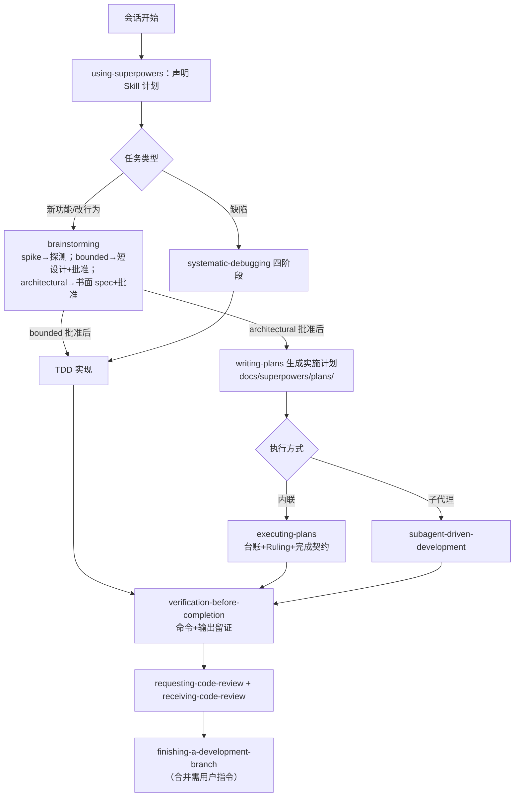

# 05 - Skill 调用与执行规范（Sky 项目 AI 辅助开发统一规范）

> 生效范围：本项目后续所有 AI 辅助开发会话。
> 事实基础：本规范中的全部 Skill 均于 2026-10-27 在本地核验存在并通读了 SKILL.md 全文。
> Skill 根目录：`E:\WorkBuddy_International\skill\`（注意：不要误用 `skil` 目录——该目录不存在）。

---

## 1. 调用方式说明（本环境的实际调用机制）

本环境（ZCode）的 Skill 工具仅注册了平台自带技能（browser/documents/pdf 等），**Superpowers 系列未注册为工具级 Skill**。因此约定实际调用方式为：

> **"调用某 Skill" = 在会话中用 Read 工具读取 `E:\WorkBuddy_International\skill\<skill-name>\SKILL.md` 全文，并在后续行动中严格遵循其流程、检查表与禁令；若该 Skill 附带脚本/模板（如 requesting-code-review/code-reviewer.md、subagent-driven-development/scripts/*），同时读取并使用。**

- 每次调用须在对话中声明：`Using [skill] to [purpose]`（using-superpowers 要求）；
- 不允许"声称已调用但未读取文件"，不允许伪造调用记录；
- 无法满足某 Skill 前提（如无子代理工具时 subagent 驱动）时，按其文内降级路径执行并记录原因。

## 2. 已安装 Superpowers Skill 清单（2026-10-27 核验）

| Skill（本地名） | 路径 | 一句话职责（摘自其 SKILL.md） | 核验 |
|---|---|---|---|
| using-superpowers | `using-superpowers\SKILL.md` | 每次对话的 Skill 发现/选择/加载纪律入口 | ✅ 已读全文 |
| brainstorming | `brainstorming\SKILL.md` | 创造性工作前：意图澄清→三路径（spike/bounded/architectural）→设计批准门 | ✅ 已读全文 |
| writing-plans | `writing-plans\SKILL.md` | 把 spec 写成任务级实施计划（RED-GREEN 步骤、Interfaces 块、自审） | ✅ 已读全文 |
| executing-plans | `executing-plans\SKILL.md` | 内联逐任务执行计划（台账、Ruling、完成契约、终审） | ✅ 已读全文 |
| subagent-driven-development | `subagent-driven-development\SKILL.md` | 每任务派实现+审查双子代理；含 `scripts\`（sdd-workspace/task-brief/review-package 已核验存在） | ✅ 已读头部+脚本核验 |
| systematic-debugging | `systematic-debugging\SKILL.md` | 四阶段根因调试铁律（无根因不修复） | ✅ 已读全文 |
| test-driven-development | `test-driven-development\SKILL.md` | RED-GREEN-REFACTOR 铁律（先失败测试） | ✅ 已读全文 |
| verification-before-completion | `verification-before-completion\SKILL.md` | 无新鲜验证证据不得声称完成 | ✅ 已读全文 |
| requesting-code-review | `requesting-code-review\SKILL.md` | 派发审查子代理（模板 `code-reviewer.md` 已核验存在） | ✅ 已读全文+模板核验 |
| receiving-code-review | `receiving-code-review\SKILL.md` | 收到审查反馈的技术严谨处理 | ✅ 已读头部 |
| using-git-worktrees | `using-git-worktrees\SKILL.md` | 隔离工作区（检测→原生工具→git 兜底） | ✅ 已读全文 |
| finishing-a-development-branch | `finishing-a-development-branch\SKILL.md` | 分支完成后的合并决策流程 | ✅ 已读头部 |
| dispatching-parallel-agents | `dispatching-parallel-agents\SKILL.md` | 2+ 独立任务并行派发 | ✅ 已读头部 |
| security-audit（辅助，非 Superpowers 主流程） | `security-audit\SKILL.md` | 安全审查指引 | ✅ 已读头部 |

> skill 根目录另有 200+ 领域 Skill（前端/数据/运维等），与本项目主流程无直接关系；需要时按第 6 节准入规则选用。

## 3. Superpowers 主工作流程（本项目标准节奏）

**开工前置**：涉及代码修改的会话，先用 `using-git-worktrees` 建立隔离工作区（或经用户同意就地建分支）；仓库基线见 `docs/00` §2。

## 4. 任务与 Skill 对照矩阵

| 任务场景 | 必须 Skill（顺序） | 备注 |
|---|---|---|
| 任何会话开始 | using-superpowers | 声明本次 Skill 计划 |
| 新功能 / 行为修改 | brainstorming →（architectural 时）writing-plans → executing-plans 或 subagent-driven-development → test-driven-development → verification-before-completion → requesting-code-review | bounded 改动无计划文档；architectural 必有 spec |
| 缺陷修复 / 构建失败 / 运行异常 | systematic-debugging → test-driven-development（回归测试）→ verification-before-completion | 禁止症状式补丁；3 次修复失败须停下质疑架构 |
| 编写任何生产代码 | test-driven-development | 先失败测试；项目测试命令：`./gradlew :app:testDebugUnitTest` |
| 声称任何"完成/通过/修复" | verification-before-completion | 无命令输出不得下结论 |
| 阶段/分支收尾 | requesting-code-review → receiving-code-review →（用户批准合并后）finishing-a-development-branch | 审查模板 `requesting-code-review\code-reviewer.md` |
| 需要隔离工作区 | using-git-worktrees | 遵守 Step 0 检测与 .gitignore 校验 |
| 多个独立任务并行 | dispatching-parallel-agents / subagent-driven-development | 注意本环境并发限制：**子代理一次仅能运行 1 个**（2026-10-27 实测），须串行派发 |
| 安全相关改动（飞控/网络/存储） | 主流程 + security-audit 辅助复查 | 不替代主流程 |

## 5. 各专项流程要点（摘自各 SKILL.md 的强制条款）

### 5.1 规划流程（brainstorming + writing-plans）
- brainstorming 三路径**必须先分类并声明**；bounded 的批准门与 architectural 同等硬（呈现设计后必须停下等用户明确 yes）；architectural 产物 spec 存 `docs/superpowers/specs/YYYY-MM-DD-<topic>-design.md` 并做占位符/一致性/歧义自审。
- writing-plans：计划保存 `docs/superpowers/plans/`；每步"一个动作+可查结果"；自审五查（覆盖/步骤/类型一致/Review Focus/篇幅）。本项目阶段计划（`docs/phases/`）是 writing-plans 的超集结构，执行时按其 Task 节直接读取。

### 5.2 开发执行流程（executing-plans / subagent-driven-development）
- 台账：`.superpowers/sdd/<plan>/progress.md`（脚本 `sdd-workspace` 生成工作区）；上下文压缩后**以台账与 git log 为准**，不靠记忆。
- Ruling 纪律：偏离计划必须记录 `Ruling: <决定> — <理由> — <错判代价>`；禁止秘密决策。
- 完成契约：任务结束前——测试存在且本轮运行过、最终运行通过、每个 Expected 与真实输出比对、每处偏离有 Ruling。
- 持续执行：任务间不停顿询问用户（除非：不可逆/破坏性操作、安全敏感、共享分支副作用、计划全面崩坏）。

### 5.3 TDD 流程（test-driven-development）
- 铁律：`NO PRODUCTION CODE WITHOUT A FAILING TEST FIRST`；测试通过前必须亲眼看到失败（失败的还须是"预期原因"）。
- 单测通过 ≠ 完成：必须跑**全项目测试命令**（本项目为 `./gradlew :app:testDebugUnitTest`），任何失败（含非己所致）必须点名上报。
- 例外（配置文件、生成代码、抛弃原型）须用户许可并记录。

### 5.4 调试流程（systematic-debugging）
- 四阶段：根因调查（读报错/复现/查变更/分层取证/追数据流）→ 模式对照 → 单假设最小验证 → 实现修复（先建失败测试）。
- 3 次修复失败 = 架构问题：停止修复，与用户讨论架构。

### 5.5 Code Review 流程（requesting / receiving）
- 审查者拿"精心构造的上下文"（diff 范围、计划/需求、BASE/HEAD SHA），**不是会话历史**。
- Critical 立即修，Important 推进前修，Minor 记录后置；对错误结论要技术性反驳而非盲从。

### 5.6 验证与验收流程（verification-before-completion）
- 门函数：识别证明命令 → 完整执行 → 读全输出与退出码 → 比对 → 才允许声明。
- 禁用词："should work / 大概 / 看起来可以"。构建通过证据 = 构建命令退出码 0；测试通过 = 0 失败计数。

## 6. 辅助 Skill 准入规则（非 Superpowers）

允许引入 skill 根目录其他 Skill，条件全部满足：① 与当前任务直接相关；② 不重复 Superpowers 已有能力；③ 不改变 Superpowers 主流程地位；④ 调用（读取了哪个文件、用于何处）记录进当次台账/汇报。当前已备案辅助：`security-audit`（安全复查场景）。**不得为了调用 Skill 而调用 Skill。**

## 7. 文档维护规则

1. 文档与代码同步义务：任何使 `docs/00~05` 描述过时的改动，**同一提交内**更新对应文档（审计矩阵 D/S 编号状态、API 清单、架构图）；
2. 状态标注强制：现状判断必须带 `[已验证]`/`[代码可见但未验证]`/`[文档描述]`/`[规划建议]`/`[待确认]` 之一；
3. 敏感信息：Key/密码/内网地址一律脱敏（`xxxx****`）或指向"见某文件某行"；LLM Key 等经 BuildConfig 注入，禁止写回文档与仓库；
4. 新 spec/计划归位：`docs/superpowers/specs/`、`docs/superpowers/plans/`（skill 默认约定），阶段级汇总回写 `docs/phases/`。

## 8. Git 安全规范

1. 默认只在 `feature/phase-*` / `feature/release-prep` 分支改业务代码，master 仅合并。本次用户已明确要求不新建分支、完成后合并同步，因此 F07/F08/F09/F11 按该明确授权在 `master` 提交和推送；不改写历史、不覆盖并行更新。
2. 禁止：`git reset --hard`、`git clean -fd`、`git push --force`、改写历史、自动 push、自动创建 PR——除非用户明确指令；
3. 每任务一提交，信息格式 `phase-NN: task-NN <描述>`；合并前必有整分支审查；
4. `.superpowers/` 工作区目录加入 `.gitignore`（首次使用时）；
5. 死代码删除、Manifest 修改、依赖变更三类操作必须单独提交并经用户批准。

## 9. 失败处理规范

| 情形 | 动作 |
|---|---|
| 测试失败 | systematic-debugging 四阶段；修复以回归测试固化 |
| 构建失败 | 先读完整报错（不跳行）；环境类问题仅做恢复性操作，禁止顺手升级依赖 |
| 真机失败 | 分层取证（注册→连接→上传→指令），事件记录进清单；安全事件立即停止一切真机任务 |
| Skill 缺失/不适用 | 记录"期望 Skill → 实际替代流程 → 原因"，禁止假装调用 |
| 外部资源缺失（设备/后端/Key） | 按对应 phase 计划 §E 的进入条件与降级路径执行并升级用户 |
| 代理（子代理）报告成功 | 按 verification-before-completion：检查 diff 与测试输出后再采信 |

## 10. 本次接手会话的 Skill 调用记录（2026-10-27）

| Skill | 状态 | 说明 |
|---|---|---|
| using-superpowers | **已实际调用**（读全文并遵循） | 指导了本次全部 Skill 的发现、选择与加载方式 |
| systematic-debugging | 已读全文（规范依据）；**实际流程未触发** | 基线构建一次成功、测试一次通过，无缺陷需调试 |
| verification-before-completion | **已实际遵循** | 构建/测试结论均留存命令、退出码、计数（`docs/00` §5） |
| test-driven-development | 已读全文；**未适用** | 本会话无代码开发 |
| brainstorming | 已读全文；**未适用** | 本会话任务边界由用户指令完整给定，无创造性设计决策；阶段计划中的架构类任务已在 phase 文档中预留其调用时机 |
| writing-plans | 已读全文；**已参照其方法论**（任务拆分/步骤化/Review Focus 结构）组织 `docs/02` 与 `docs/phases/`，但未走其 spec→计划→交接审批链（本会话交付物即计划文档本身，审批权在用户） | 区分记录，不夸大 |
| requesting-code-review | 已读全文；**未派发审查子代理**（交付物为文档而非代码；改用本会话末尾的文档交叉审查 + 脚本校验，方法与局限如实记录） | 见 §10 限制说明 |
| executing-plans / subagent-driven-development / dispatching-parallel-agents / finishing-a-development-branch / using-git-worktrees | 已读全文或头部；**规划未来调用**（Phase 01 起） | phase 计划已内置调用声明 |
| security-audit | 已读头部；**辅助**：审计报告 §8/§9 的安全视角参考 | 已备案 |

**限制说明（诚实记录）**：① 本环境子代理并发上限为 1，Phase 计划中"并行子代理"执行时须串行派发；② 平台未注册 Superpowers 为工具级 Skill，"调用"以读取+遵循为语义（§1），后续若平台注册了同名 Skill 工具，应优先用工具调用并以本文件路径为准做内容映射。
